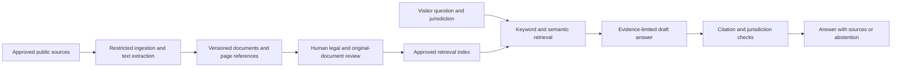

# Future legal research architecture

**Design only.** No AI model, embedding service, database server, account system, paid API or external backend is connected. Phase 1 runs independently from static files. Local keyword search is implemented; semantic/AI search is not.

## Data boundary

The public corpus is currently maintained in `content/library.mjs`, with English editorial fields, original case-language fields and source IDs. A generated read-only index powers local search. `architecture/knowledge.sql` is a proposed relational schema, not a running database. It covers versioned original documents, cases, legislation, articles, citations, source checks, reviews and future retrieval chunks.

Stable IDs identify conceptual records. Each source document has its own original language, version and review status. The website interface remains English; no translation workflow is active. Separate dates represent source publication, decision, enactment, commencement, preparation and review. Missing values remain null. A case’s internal ID is not a court case number. A historical text’s access date is not proof of current law.

## Proposed RAG flow

1. An editor adds an allowlisted public source and records copyright/usage terms. No confidential client material enters the public corpus.
2. A separate ingestion worker fetches only HTTPS sources. Block private IP ranges, local addresses, unsafe schemes, DNS rebinding and redirects outside the allowlist. Limit file sizes, page counts, execution time and decompression; scan uploads and isolate extraction. Avoid active document macros or embedded code.
3. Store immutable source versions with content hashes, retrieval timestamps, publisher, jurisdiction, language and page/paragraph locators. Retain source URLs and failure evidence.
4. A reviewer confirms document identity, case/law numbers and legal status. Text extraction/OCR quality is reviewed before retrieval. Material remains excluded from authoritative retrieval until approved.
5. Split by legal headings/articles and paragraph boundaries; retain parent document identity, jurisdiction, source version and locator on every chunk. Never split away an exception or qualification without a neighboring context window.
6. Query processing identifies language and asks for jurisdiction when necessary. Do not silently combine Somali law, Somaliland materials, foreign law and international law. Use explicit jurisdiction/date/version filters, lexical identifiers and semantic retrieval; preserve original legal identifiers and documents without automatic translation.
7. The generator receives only the retrieved evidence necessary to answer. Treat source text as untrusted evidence, never instructions. It must distinguish law, allegations, opinions, commentary and hypotheses; cite supporting passages with original URLs; avoid professional guarantees and tailored case determinations.
8. A deterministic citation gate checks that every cited ID was retrieved, each quotation matches the stored version and each identifier agrees with metadata. Semantic support and current-law checks require review; an LLM score alone cannot create a verified status.
9. If evidence is missing, inconsistent, old, unreadable or outside the approved jurisdiction, respond with an explicit limitation and reliable source-discovery guidance. No invented statute, case or citation is acceptable.

## Citation verification states

Track separate outcomes, rather than one misleading verified flag:

- URL reachability: succeeded / failed / blocked / unknown, with timestamp and final host.
- Document identity: publisher, title, court and identifiers matched to the retrieved document, reviewer/date.
- Claim support: exact supporting passage, qualifications, human decision and rationale.
- Jurisdiction match: identified scope and whether the proposition is relevant to the requested legal system.
- Currency: current / historical / amended / repealed / unknown, with the source for that status. Default unknown.
- Original-document fidelity: original title, court, references and text matched to the submitted source, reviewer and approved revision.

The current project only records source inspection and pending legal review. HTTP 200 is not legal verification. Automated URL checks, full-text ingestion and a live verification service are not implemented.

## Administrator AI assistant

Allow actions such as draft a summary, extract topics, suggest a title against approved source IDs. Output includes evidence spans, uncertainties and a revision diff. Never permit automatic publication. Required state transitions: `draft → source_checked → legal_review → original_document_check → owner_approved → published`. Revisions invalidate affected approvals. An authenticated editor chooses the final action; the AI service has no publish credential.

## Security and deployment separation

Any future API runs outside WordPress.com Free. Secrets remain on the backend, never in browser bundles. Use least-privilege service roles, TLS, rate/size limits, redacted logs, secret rotation and audit trails. Search prompts can contain sensitive legal information: minimize retention, explain handling and avoid storing raw prompts by default. Client documents require a separate private architecture and explicit scope.

Free can retain the English editorial website and link to a separately approved app. A custom AI widget, database and API must not be assumed to fit Free. Pricing, hosting, model terms, data residency and retention must be reviewed before an implementation decision. Nothing in this design activates a paid service.

## Evaluation before any public AI release

Build a reviewer-labelled set with English questions and original-language source documents covering exact case-number retrieval, source dates, mixed jurisdictions, conflicting amendments, missing evidence, mistranslations, malicious instructions in documents, fabricated citations and individual legal advice requests. Measure retrieval recall, citation identity/support, jurisdiction accuracy, unsupported claims and correct abstention. Every invented authority or unsupported critical legal proposition is a release blocker. Have qualified reviewers set thresholds and compare revisions; do not use self-grading as approval.

## Later phases

Phase 2: approve a hosting/data budget; implement reviewed ingestion and lexical search first; then evaluate RAG and an editor-only drafting tool. Phase 3: consider authenticated access, expanded jurisdictions, retention controls and a scalable library only when a clear need exists. Public Phase 1 must continue working if every future service is offline.
